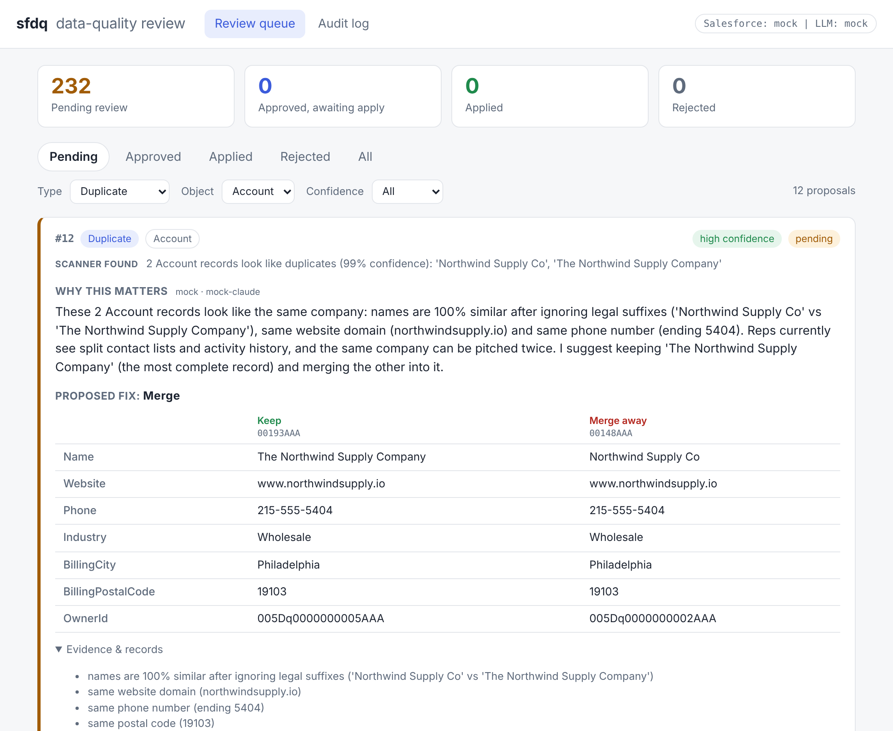
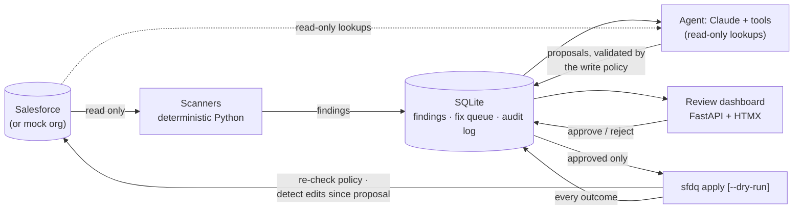

# sfdq: Salesforce data-quality agent

[](https://github.com/itpro9167/sf-data-quality-agent/actions/workflows/ci.yml)


Dirty CRM data quietly taxes every sales team: reps call dead numbers, pitch the same company twice from
two duplicate records, and chase contacts who left a year ago. **sfdq** audits Salesforce Accounts and
Contacts with deterministic scanners, then uses Claude to explain each problem in plain business English
and propose a specific fix. The design principle is **the AI proposes, a human approves**: the model has no
write access, every proposal waits in a review queue, and only an explicit `sfdq apply` (with `--dry-run`)
touches Salesforce, logging every action to a tamper-evident audit trail.



## Quickstart (mock mode: no Salesforce org, no API key)

```bash
pip install -e .                  # or: uv pip install -e .
sfdq scan && sfdq propose        # 232 findings in a fake org -> 232 pending proposals
sfdq review                      # open http://127.0.0.1:8000, approve some, then: sfdq apply --dry-run
```

Then approve a few fixes in the dashboard and run `sfdq apply --dry-run` (see exactly what *would* change), then
`sfdq apply`, then `sfdq scan` again to watch the findings disappear. `sfdq reset-demo` starts over.

## How it works



| Stage | Command | What happens | LLM? | Writes to Salesforce? |
|---|---|---|---|---|
| Scan | `sfdq scan` | Four scanners over Accounts and Contacts → findings | No | No |
| Propose | `sfdq propose` | Claude explains each finding and proposes **merge**, **update field** or **flag for owner review** | Yes | No |
| Review | `sfdq review` | Dashboard shows before/after values; a human approves or rejects | No | No |
| Apply | `sfdq apply [--dry-run]` | Applies **approved** proposals only | No | **Yes**, only here |

**The four scanners** (all configurable per object in [`quality_rules.yaml`](src/sfdq/config/quality_rules.yaml)):

- **Likely duplicates**: fuzzy name + website domain / email / phone matching, scored with a confidence (see below)
- **Missing key fields**: required fields per object
- **Stale records**: no activity *and* no edits in 12+ months
- **Invalid formats**: email, phone and postal code (per-country patterns), with mechanical repairs where unambiguous

## Example: one finding, end to end

Scanner output (deterministic, no LLM):

```text
2 Account records look like duplicates (99% confidence):
'Northwind Supply Co', 'The Northwind Supply Company'
  - names are 100% similar after ignoring legal suffixes
  - same website domain (northwindsupply.io)
  - same phone number (ending 5404)
  - same postal code (19103)
```

What the agent returns after reading both live records (shown here from mock mode's canned response;
real Claude writes its own wording but must fill in the same structure):

> **Merge** · *high confidence*
> These 2 Account records look like the same company: names are 100% similar after ignoring legal suffixes,
> same website domain (northwindsupply.io) and same phone number (ending 5404). Reps currently see split
> contact lists and activity history, and the same company can be pitched twice. I suggest keeping
> 'The Northwind Supply Company' (the most complete record) and merging the other into it.

And a judgment call, where the agent restores a lost leading zero but marks it **medium** so the reviewer looks:

> **Update field** · *medium confidence* · `BillingPostalCode`: ~~2108~~ → **02108**
> The billing postal code stored for 'Aspen Brewing Co' is '2108', which isn't a valid postal code. MA ZIP
> codes begin with 0, and spreadsheet imports often drop it, so I restored it. Worth a quick look.

## Live demo

> **Live demo:** _not deployed yet._ After you deploy (below), replace this line with your URL, for example
> `https://sfdq-demo.onrender.com`.

The demo is the review dashboard running in **mock mode with sample data preloaded** (232 pending proposals on a fake org).
It is safe to expose: a visitor can approve, reject and undo, but nothing can reach Salesforce (there is no shell to run
`sfdq apply`, and there are no credentials). The queue is shared by all visitors, and a **Reset demo data** button restores it.
`SFDQ_PUBLIC_DEMO=1` makes sfdq refuse to start if real credentials are present, since the dashboard has no login.

**Deploy to Render (free plan):**

[](https://render.com/deploy?repo=https://github.com/itpro9167/sf-data-quality-agent)

1. Click the button, or in the Render dashboard choose **New + → Blueprint** and pick this repository. Render reads
   [`render.yaml`](render.yaml) and builds the [`Dockerfile`](Dockerfile).
2. Wait for the build (a few minutes). The service `sfdq-demo` gets a URL like `https://sfdq-demo.onrender.com`.
3. Paste that URL into the "Live demo" line above.

Free instances spin down after about 15 minutes idle (the next visit takes ~30-60 s to wake) and the disk is ephemeral, so the
demo resets whenever the service restarts or redeploys.

**Run the same image locally:**

```bash
docker build -t sfdq-demo .
docker run --rm -p 8000:8000 sfdq-demo      # open http://localhost:8000
# if Docker Hub rate-limits you:  --build-arg PYTHON_IMAGE=mirror.gcr.io/library/python:3.12-slim
```

I built and ran this image locally (sample data seeds on first start, the dashboard serves, the container runs as a
non-root user, Docker's health check reports healthy, and a restart does not re-seed), and CI builds and smoke-tests it on every
push. I have **not deployed it to Render**, so `render.yaml` is validated against my tests but not against Render itself.

## MCP server: drive sfdq from Claude Desktop (or any MCP client)

`sfdq mcp` runs a [Model Context Protocol](https://modelcontextprotocol.io) server (built on the official
Python MCP SDK) so an AI client can scan, propose and review conversationally. It works in mock mode out of the box.

| Tool | What it does | Changes Salesforce? |
|---|---|---|
| `run_scan` | Run the deterministic scanners, save findings | No (reads only) |
| `list_findings` | Page through findings, filter by issue type / object / has-a-proposal | No |
| `propose_fix` | Have the agent propose a fix for one finding (queued as `pending`) | No |
| `list_pending_fixes` | Proposals awaiting review, with explanation and before/after values | No |
| `approve_fix` | Mark a proposal approved. Requires `confirm=true` | **No**, only flips a queue row |
| `reject_fix` | Mark a proposal rejected | No |

**There is deliberately no `apply` tool.** Applying approved fixes stays a human action on the CLI
(`sfdq apply --dry-run`, then `sfdq apply`). This is structural rather than a convention: the scanners and the agent
inside the server only ever receive a `ReadOnlySalesforceClient` that raises on every write, and the server module never
imports the apply engine (both are covered by tests). Approvals made over MCP are recorded in the audit log as
`mcp:<reviewer>`, and `approve_fix` refuses unless the client passes `confirm=true`, which its instructions say to do
only after the human has explicitly asked. That makes the human gate only as strong as the human in the chat, so
review in the dashboard if you want a stricter workflow.

**Claude Desktop config** (Settings → Developer → Edit Config, i.e. `claude_desktop_config.json`; restart Claude
Desktop afterwards). Use absolute paths to the `sfdq` executable of the virtualenv where you ran `pip install -e .`:

```json
{
  "mcpServers": {
    "sfdq": {
      "command": "/absolute/path/to/sf-data-quality-agent/.venv/bin/sfdq",
      "args": ["mcp"],
      "env": {
        "SFDQ_MODE": "mock",
        "SFDQ_HOME": "/absolute/path/to/sf-data-quality-agent/.sfdq"
      }
    }
  }
}
```

On Windows use `"command": "C:\\path\\to\\sf-data-quality-agent\\.venv\\Scripts\\sfdq.exe"`. If the executable is not
found, `"command": "<venv python>", "args": ["-m", "sfdq.cli", "mcp"]` is equivalent, and `sfdq-mcp` is an alias entry point.
Point `SFDQ_HOME` at the same folder you use for the CLI and dashboard so they share one queue. To use real services, add
`ANTHROPIC_API_KEY` and/or the `SF_*` variables to `env` instead of `SFDQ_MODE`.

Then try: *"Scan our Salesforce for data-quality problems, show me the five most likely duplicate accounts, propose a
fix for the top one, and tell me what you'd change."* followed by *"Approve it."* The fix is then applied from your
terminal with `sfdq apply --dry-run` and `sfdq apply`. An HTTP transport is available with
`sfdq mcp --transport streamable-http` (no authentication; localhost only by default).

I tested the server with the official MCP Python client over both an in-process connection and a real stdio subprocess,
but not inside the Claude Desktop app itself.

## Eval harness: does the agent actually fix things correctly?

`sfdq eval` runs the agent over every seeded problem in the mock org, compares each proposal with a labeled
expected-fixes file, and reports **precision and recall per issue type** plus a markdown report
([sample report](docs/eval-report.md)). It uses the mock LLM by default and real Claude when `ANTHROPIC_API_KEY` is set
(`--mock` forces the mock). It runs on a freshly generated org and persists nothing.

```bash
sfdq eval                                   # writes eval-report.md
sfdq eval --json results.json --min-auto-precision 0.95   # exit 1 if wrong auto-fixes creep in (CI gate)
ANTHROPIC_API_KEY=... sfdq eval --limit 20  # try real Claude on a small sample first
```

**Where the labels come from.** The generator records the *correct* value of every field it corrupts, and
[`expected_fixes.json`](src/sfdq/eval/data/expected_fixes.json) says what a careful analyst would do: restore the value when
the data allows it, merge the right records, or *ask the owner* when it does not. So the agent is scored against reality, not
against itself. Each fixable label has a difficulty tier (*mechanical*: follows from the bad value; *needs context*: needs
the state, the Account's website, or a record comparison), and a test fails if the committed labels drift from the generator.

**What is measured.** Auto-fix precision (of the merges and updates it proposed, how many were exactly right: the number to
protect, since a wrong auto-fix corrupts data), auto-fix recall, *restraint* (asked the owner where it should, with a count of
unsafe auto-fixes), and detection precision/recall for the deterministic scanners, including look-alike decoys.

Baseline with the canned mock agent (232 seeded problems):

| Issue type | Seeded | Detection P / R | Auto-fix precision | Auto-fix recall | Asked owner correctly |
|---|---:|---:|---:|---:|---:|
| Duplicates | 30 | 100% / 100% | 100% (30/30) | 100% (30/30) | n/a |
| Missing fields | 68 | 100% / 100% | 100% (8/8) | 100% (8/8) | 100% (60/60) |
| Stale records | 98 | 100% / 100% | n/a | n/a | 100% (98/98) |
| Invalid formats | 36 | 100% / 100% | 100% (20/20) | 87% (20/23) | 100% (13/13) |
| **All** | **232** | **100% / 100%** | **100% (58/58)** | **95% (58/61)** | **100% (171/171)** |

Read this baseline with care: the mock agent's canned logic was written with these same problem types in mind, so its high
score validates the *pipeline and the harness*, and gives a regression baseline, not evidence of how Claude performs. Its
three misses are the context-dependent email repairs (a missing `.com`, a missing `@`, a space in the local part) that need
the Account's website, which is exactly the kind of case a tool-using LLM should win. I have **not** run the eval against
real Claude (no API key in my environment), so there are no real-model numbers here yet. The harness is tested
to tell good from bad: a deliberately reckless agent scores under 30% precision with over 100 unsafe auto-fixes, and a timid
agent that only flags scores 0% recall and zero unsafe fixes.

## Design decisions

**Deterministic scanners + LLM reasoning.** Finding problems is a precision/recall exercise that must be
repeatable, testable and cheap, so it is plain Python: the same org always yields the same findings, and each
scanner is scored against a ground-truth manifest of seeded problems (exact match, zero false positives
including "same name, different company" decoys). The LLM is used only where judgment and language matter:
*is this really the same company? which record should survive? what should I tell the reviewer? is this
missing website inferable from the contacts' email domains?* This also keeps token spend proportional to the
number of findings, not the size of the org.

**Explainable duplicate scoring.** Each signal (name, domain, phone, email, postal, same account) contributes an
independent probability, combined as `1 - Π(1 - pᵢ)`. A shared common name alone can never reach the threshold, but
name + phone does; clusters are scored by their weakest edge. Weights live in YAML, and every finding carries
the evidence list that the reviewer sees.

**Human approval is structural, not a prompt.** The model's only "write" is `submit_proposal`, which validates
and *captures* a draft. The queue enforces `pending → approved|rejected`; `sfdq apply` loads only `approved` rows
and the applier refuses anything else even if called directly. The dashboard has no Salesforce credentials at all.

**Defense in depth against bad (or manipulated) model output.** CRM free text can contain prompt injection, and
models make mistakes, so several independent layers apply:
1. *Write policy*: a field allow-list from YAML (no `OwnerId`, `AccountId`, `Id`...), proposed values must pass the same
   format validators, and every record must belong to the finding. Enforced when a proposal is created **and again at apply time**.
2. *`before` values come from the live record*, never from the model, so the next layer is meaningful.
3. *Optimistic concurrency at apply*: each record is re-read; if a `before` value changed since the proposal
   (or a record was merged/deleted) the proposal is skipped as a **conflict** instead of overwriting someone's edit.
4. *Scoped read tools*: the agent can only read the finding's records plus records its lookups returned.
5. *Errors go back to the model*: a rejected proposal is returned as a tool error so it can self-correct, and after the
   attempts run out a conservative *flag-for-review* fallback is queued, so no finding silently disappears.
6. *Prompt hygiene*: record data is JSON-encoded with `<` escaped so it cannot close the prompt's `<finding>` block.

**How the audit log works.** Every scan, proposal, approval, rejection, undo, dry run and apply result is written to
SQLite **in the same transaction as the state change**, so the log can't disagree with the data. The table is
append-only (triggers abort `UPDATE`/`DELETE`) and hash-chained: each row stores
`sha256(prev_hash + canonical(entry))`. `sfdq audit` (and the dashboard's audit page) re-verifies the chain end to end,
so editing the database file out-of-band is detected even if someone drops the triggers.
Dry runs are logged too, with the exact operations that *would* have run.

**"Flag for owner review" is a real, safe action.** Stale records, ambiguous duplicates and missing data the agent
can't derive become a Salesforce **Task assigned to the record owner** containing the agent's question. The agent
never proposes deleting or archiving anything.

**Mock mode is a first-class implementation, not a stub.** `MockSalesforceClient` implements the same protocol as
the real client (including merge re-parenting and `LastModifiedDate` bumps) and persists to `.sfdq/mock_org.json`, so
`apply` is visible to the next `scan`. `MockLLMClient` speaks Claude's *tool-use protocol*: it asks for live records
via `get_record`, reads the results, and calls `submit_proposal`, so the real agent loop, tool validation and write
policy all execute in mock mode and in every test. The mock org (200 Accounts, 500 Contacts) is generated
deterministically with seeded problems: 12 + 18 duplicate clusters, 68 records with gaps, 98 stale records and 36
invalid values, plus decoys that look like duplicates but aren't.

## Real mode

Each component goes real only when *its* credentials are present, and every command prints which is which
(`Salesforce: mock | LLM: claude (claude-opus-5-5)`). Copy [`.env.example`](.env.example) to `.env` (gitignored):

| Variable | Effect |
|---|---|
| `SF_USERNAME`, `SF_PASSWORD`, `SF_SECURITY_TOKEN` (+ `SF_DOMAIN=test` for sandboxes) | Real Salesforce via `simple-salesforce` |
| `ANTHROPIC_API_KEY` | Real Claude via the official Anthropic SDK (default model `claude-opus-5-5`; override with `SFDQ_MODEL`) |
| `SFDQ_MODE=mock` / `real` | Force mock even if credentials exist / require both |

Guard rails: `propose` asks before sending more than 25 findings to a paid API (use `--limit N` to try a few first),
`apply` asks for confirmation, and `reset-demo` refuses to run against a real org. Try a sandbox first.

## Project layout

```text
src/sfdq/
  scanners/     duplicates.py · missing_fields.py · stale.py · formats.py   (deterministic, no LLM)
  agent/        llm.py (Claude client) · mock_llm.py · tools.py · prompts.py · proposer.py (the loop)
  queue/        store.py (SQLite queue) · audit.py (hash chain) · applier.py (the only writer)
  salesforce/   base.py (protocol) · real.py · mock.py · mock_data.py (seeded org generator)
  web/          app.py (FastAPI) · templates/ + static/ (HTMX, vendored, no CDN, no build step)
  policy.py     write policy shared by the agent and the applier
  config/quality_rules.yaml   per-object rules, thresholds, writable fields
  cli.py        sfdq scan | propose | review | apply | status | audit | reset-demo
tests/          199 tests: scanners vs ground truth, queue/audit/apply safety, agent loop, web, e2e
```

## Development

```bash
pip install -e ".[dev]"
ruff check src tests && ruff format --check src tests
mypy                  # strict
pytest                # fully offline
```

CI runs the same on Python 3.11-3.13. The suite includes an end-to-end test that drives the real CLI and
dashboard through scan → propose → approve → `apply --dry-run` → apply → re-scan.

## Status and honest limitations

- The **real Salesforce and real Claude paths are tested against stand-ins, not live services**: the Salesforce client
  against a stub `simple-salesforce` object (SOQL generation, escaping, ID validation, Apex merge payloads), and the
  Anthropic client against real SDK response/exception types. I have not run them against a live org or a paid API key,
  so try a sandbox org first. Record merges in real mode use Apex `Database.merge` via the Tooling API
  (`executeAnonymous`) because the REST API has no merge verb.
- The dashboard has **no authentication** and binds to localhost by default; put it behind a proxy with auth before
  sharing it. Reviewer identity is taken from `SFDQ_REVIEWER`/OS user, not a login.
- Merging only fills **blank** fields on the survivor (the agent is instructed to, and the write policy limits edits to
  the survivor); other differences are resolved in favour of the survivor.
- Scale: duplicate detection uses blocking (shared domain / phone / email / name-token prefix) to stay near-linear, and
  has only been exercised on the 700-record demo org.

## Roadmap

- More objects: Leads, Opportunities, custom objects (rules are already keyed per object)
- **Slack approvals**: post a proposal with Approve / Reject buttons to the record owner's channel
- **Scheduled scans** (cron / GitHub Actions) that open only *new* findings and report drift over time
- Batch API for large `propose` runs, and a spend cap per run
- Per-field approval for multi-field proposals; SSO for the dashboard
- Confidence calibration: track approval rates per confidence level to tune the agent and thresholds

## License

MIT
